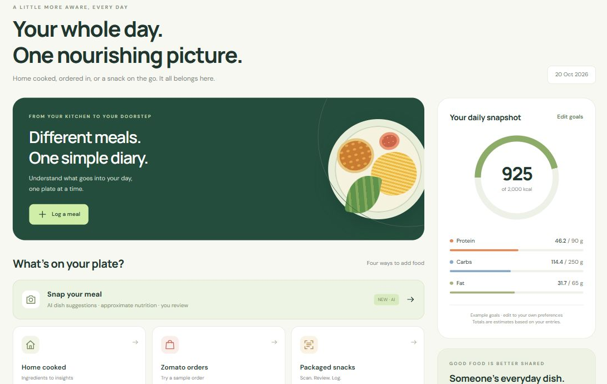

# Thali

An AI-assisted food diary for the way India eats: home cooking, restaurant orders and packaged snacks in one daily view.

Independent student prototype for Eternal Hackathon Showcase 2026. It is not an official Eternal, Zomato or Blinkit product.



## What works

- **Meal photo estimates:** real on-device image inference suggests likely dishes. Users choose the match, confirm cooked portions and save approximate calorie and macro ranges.
- **Home cooking:** ingredient quantities, cooking oil, cooked yield and portion calculations.
- **Sample orders:** confirm the amount eaten before logging a fictional Zomato order.
- **Snack labels:** browser OCR, manual review, per-100-g or per-serving normalization and grams eaten.
- **Community recipes:** share, save and log recipes in a local demo feed.
- **Daily tracking:** editable example goals, browser persistence and JSON export.

## Run locally

No build step or API key is required. Serve the `dist` folder over HTTP:

```bash
git clone https://github.com/Navigam1108/thali.git
cd thali
python -m http.server 4173 --directory dist --bind 127.0.0.1
```

Open **http://127.0.0.1:4173**. Use an HTTP server rather than opening the HTML file directly.

The first AI scan downloads about **155 MB of model weights plus the runtime**. Subsequent scans can use the browser cache. Warm the model before a live presentation. Photos remain on-device. If inference cannot run, the app offers manual dish selection.

## Presentation and proposal

- [Pitch deck for Eternal employees](docs/Thali_Eternal_Pitch.pptx)
- [Presenter guide and two-minute demo](docs/Presenter_Guide.md)
- [Detailed problem statement with screenshots](docs/Thali_Problem_Statement.pdf)
- [Implementation notes and limitations](docs/Prototype_Notes.md)

The hosted demo is owner-private and requires ChatGPT sign-in. The local app is the easiest way to demonstrate it to an audience without shared site access.

## Checks

With Node.js 22 or newer:

```bash
npm test
npm run check
```

The 12 automated tests cover portions, label bases, missing values, recipe yield, photo scenario ranges, known extra oil and diary aggregation. They do not establish model or nutritional accuracy.

## How it works

| Component | Implementation |
| --- | --- |
| Interface and diary | Buildless HTML, CSS and JavaScript |
| Meal image matching | Transformers.js 3.8.1 and quantized CLIP in a Web Worker |
| Nutrition estimates | Deterministic calculations from illustrative references |
| Label reading | Tesseract.js 5.1.1 with mandatory review |
| Storage | Browser localStorage, no shared backend |

The CLIP model is pinned to `Xenova/clip-vit-base-patch32` revision `d15189d7028b43f1d3e65039190477f6af591c2a`.

## Prototype boundaries

The model ranks 20 dish descriptions. It does not segment mixed plates, weigh food or measure nutrients from pixels. It can suggest incorrect foods, including for unsupported images. Users explicitly confirm every dish and portion.

Nutrition references are illustrative. Photo ranges are scenario bounds based on assumed portion and recipe variation, not validated confidence intervals. The app does not infer hidden oil or provide clinical recommendations.

Restaurant names, orders and their nutrient values are fictional examples. No Zomato or Blinkit account or private API is connected. Recipe sharing is local to the browser. Authentication, cross-device sync, moderation, reviewed composition data and approved integrations are future work.

## Attribution

The sample idli and sambar photo is by **Sutapa Pal**, via [Wikimedia Commons](https://commons.wikimedia.org/wiki/File:Idli_Sambar-Noida-UP-SP004.jpg), licensed [CC BY-SA 4.0](https://creativecommons.org/licenses/by-sa/4.0/). A resized preview is included and credited in the app. See [third-party notices](THIRD_PARTY_NOTICES.md).
